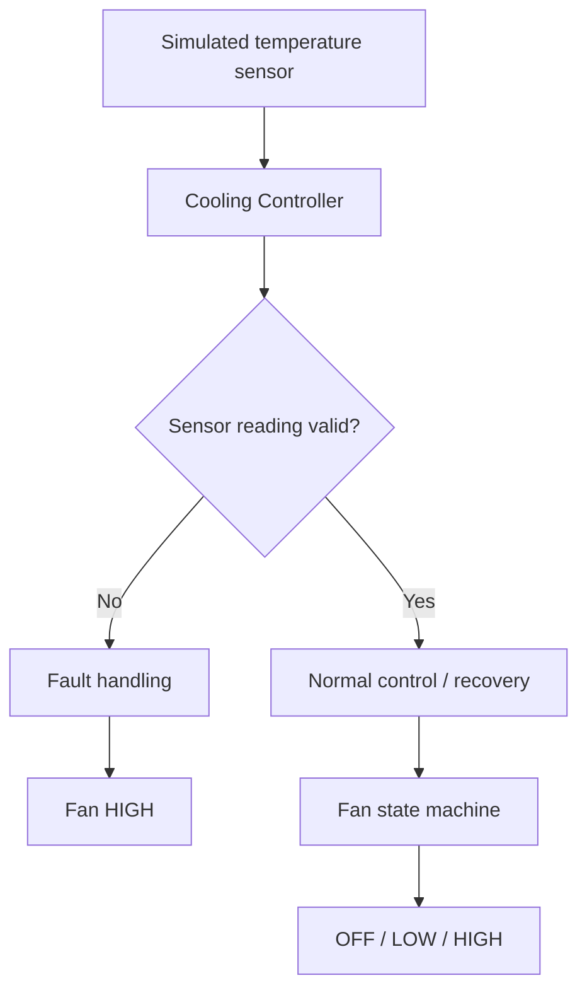

# Engine Cooling Controller

A modular engine cooling controller developed in Embedded C, featuring two-stage fan regulation using hysteresis, sensor validation, fault handling, and automated unit tests.

The project demonstrates fundamental embedded software concepts, including state management, threshold-based control, defensive programming, and software verification.

## Features

- Three fan states: OFF, LOW, and HIGH
- Configurable temperature thresholds
- Hysteresis to prevent frequent state switching
- Detection of invalid or implausible sensor readings
- High-speed fan fallback during sensor faults
- Fault recovery after three consecutive valid readings
- Eight automated test scenarios
- Continuous integration using GitHub Actions

## System Architecture



The application separates the cooling logic from the simulation. This allows the controller to be tested independently.

## Cooling Logic

The controller uses the following temperature thresholds:

| Transition | Temperature |
|---|---|
| OFF to LOW | 100°C |
| LOW to OFF | 95°C |
| LOW to HIGH | 110°C |
| HIGH to LOW | 105°C |

When the fan is OFF, a temperature of 110°C or above activates HIGH directly.

Hysteresis prevents unnecessary fan switching when the temperature fluctuates near a threshold.

## Sensor Fault Handling

The controller treats a reading as invalid when:

- The simulated sensor reports invalid data.
- The temperature is outside the plausible range of -40°C to 150°C.

When a fault occurs, the controller:

1. Sets the sensor fault flag.
2. Resets the recovery counter.
3. Commands the fan to HIGH.

The fault remains active until three consecutive valid readings are received. An invalid reading during recovery resets the counter.

This is a simplified fallback strategy for the simulation, not a production-grade safety mechanism.

## Project Structure

```text
include/
  cooling_controller.h       Controller types and function declarations

src/
  cooling_controller.c       Cooling logic and fault handling
  main.c                     Temperature simulation

tests/
  test_cooling_controller.c  Automated tests

.github/workflows/
  ci.yml                     Continuous integration
```

## Build and Run

### Requirements

- GCC compiler with C11 support
- Windows CMD or a Linux terminal
- No external C libraries

### Windows

Compile the simulation:

```cmd
gcc -std=c11 -Wall -Wextra -Werror -Iinclude src\main.c src\cooling_controller.c -o cooling_sim.exe
```

Run it:

```cmd
cooling_sim.exe
```

### Linux

```bash
gcc -std=c11 -Wall -Wextra -Werror -Iinclude src/main.c src/cooling_controller.c -o cooling_sim
./cooling_sim
```

## Automated Testing

The project includes eight tests covering:

1. Normal fan operation
2. Low-speed hysteresis
3. High-speed hysteresis
4. Direct HIGH activation
5. Sensor failure
6. Implausible temperature
7. Fault recovery
8. Interrupted recovery

### Run tests on Windows

```cmd
gcc -std=c11 -Wall -Wextra -Werror -Iinclude tests\test_cooling_controller.c src\cooling_controller.c -o cooling_tests.exe
cooling_tests.exe
```

### Run tests on Linux

```bash
gcc -std=c11 -Wall -Wextra -Werror -Iinclude tests/test_cooling_controller.c src/cooling_controller.c -o cooling_tests
./cooling_tests
```

The expected result is:

```text
All 8 tests passed.
```

The tests use standard C assertions, without an external testing framework.

GitHub Actions also compiles the simulation and executes the tests on Ubuntu whenever changes are pushed to `main` or a pull request targets `main`.

## Requirements and Test Coverage

| ID | Requirement | Test |
|---|---|---|
| R1 | Activate LOW cooling at 100°C | Normal operation |
| R2 | Apply LOW hysteresis | Low-speed hysteresis |
| R3 | Apply HIGH hysteresis | High-speed hysteresis |
| R4 | Support direct HIGH activation | Direct high-speed activation |
| R5 | Detect invalid sensor readings | Sensor failure |
| R6 | Reject implausible temperatures | Invalid temperature |
| R7 | Recover after three valid readings | Fault recovery |
| R8 | Restart recovery after another fault | Interrupted recovery |

This table maps the main implemented behaviors to automated test scenarios. It is not evidence of complete requirements coverage.

## Limitations

This project is an educational PC simulation, not production embedded firmware.

It does not implement:

- Physical sensor acquisition or fan actuation
- Real-time scheduling or timing guarantees
- Hardware communication interfaces
- Hardware failure detection for the fan itself
- Functional-safety certification or compliance

The fault thresholds and recovery policy were selected for demonstration purposes.
